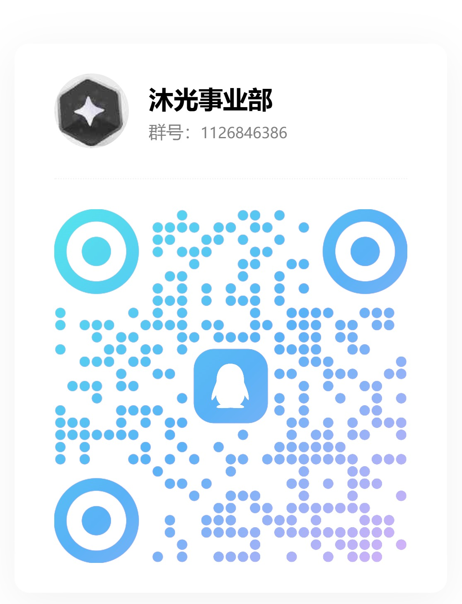

# 沐光 (Muguang)

> 趣智校园的第三方无广告平替 · Android（Kotlin / Jetpack Compose）· v1.0 · MIT

官方的趣智校园，能用的功能就那几个，但开屏、活动、推荐一样不少。沐光只做该做的事：打开就能启停热水、看余额和账单，
不弹广告、不推活动、不收集多余信息。

> 第三方客户端，与设备运营方、学校均无隶属关系。账号、余额、订单全部由服务端裁决，本应用只做展示与转发。

## 功能

- **热水**：扫码或用附近设备列表启停，按剩余金额/时长自动结算，用完自动停
- **账单与余额**：消费分类、趋势、按项目隔离，余额实时向服务端拉取
- **账户充值**：支付宝下单，应用内直接拉起支付宝完成付款，付完重新向服务端拉余额，本地不记账。
  聚合收银台、校园卡两条通道代码里支持，但需要学校开通，实际没有开通，页面上也不会出现
- **洗衣机（内测）**：绑定一台机器常驻首页看状态与预计结束时间。这块还在内测，
  状态刷新偶尔偏慢、个别机型可能不稳定，遇到问题欢迎提 issue
- **桌面小组件**：1×1 / 2×2 / 2×4，直接启停
- **检查更新**：登录后自动检查新版本，应用内直接下载安装，不用回来找安装包
- **界面风格**：四套视觉语言（默认 / 极简 / 暖纸 / 终端）× 日夜双模，设置里随时切换

## 说明

- 充值只是把学校的下单接口转成可点的界面，钱直接进学校账户，**余额永远以服务端为准**；
  支付结果「处理中 / 结果未知」时不显示失败，避免诱导重复支付
- 洗衣机走蓝牙，功能仍在打磨，**内测阶段请以机器面板显示为准**
- 界面风格只是换皮，四套结构完全一致，不影响功能；实现是 `ui/design/` 里的 `StylePack`
  令牌（调色板 / 形状 / 字体 / 面板），页面不写死颜色

## 安装

到本仓库的 **Releases** 页面下载最新 APK，在手机上打开安装即可。

- 最低系统版本 **Android 8.0（API 26）**
- 只打 **arm64-v8a**，纯 32 位的老机型装不上
- APK 由本项目自己的签名密钥签名，不是应用商店版本

## 反馈与售后

用着不对、想提需求，欢迎来官方售后群：**QQ 群 1126843866（沐光事业部）**，
扫码进群，或者在 [Issues](https://github.com/Ranxian/muguang/issues) 里留言。



> 群里只聊沐光本身的使用问题。账号、余额、订单这类事请找学校或官方客服——
> 钱不经过本项目，服务端的数据我们也改不了。

## 构建

```bash
# JDK 21 + Android SDK 36
./gradlew :app:assembleDebug
./gradlew :app:testDebugUnitTest
```

Release 需要 `local.properties` 里的签名四项（`KEYSTORE_FILE` / `KEYSTORE_PASSWORD` / `KEY_ALIAS` / `KEY_PASSWORD`）；
缺任意一项时 release 包保持未签名，debug 不受影响。

本机（Windows + 受限页面文件）跑 R8 会 OOM，因此 `release` 关闭混淆，仅用于自用验证。

## 测试

164 个单元测试，覆盖洗衣机状态机与剩余时间优先级、结算引擎、账单日期解析、BOM 隔离、时间显示策略、
版本号比较、Release 响应解析、日志脱敏等纯逻辑。

## 发布

打 tag 即发版，`.github/workflows/release.yml` 会跑测试、构建签名 APK、附到 GitHub Release，
并在配了 `GITEE_TOKEN` 时同步建 Gitee 发行版传同一份附件。所需 secrets 与手动步骤见
[RELEASING.md](RELEASING.md)。

## 目录

```
app/src/main/java/io/github/ranxian/muguang/
├── api/       网络、签名、更新检查
├── ble/       蓝牙帧与设备查询
├── data/      仓储、控制器、结算、状态机
├── model/     数据模型
├── service/   前台服务、小组件蓝牙
├── ui/        界面
│   └── design/  设计系统（令牌 / 风格包 / 组件 / 动效）
├── utils/     偏好、日志、加密、通知
└── widget/    桌面小组件
```

## 相关文档

- [PROJECT.md](PROJECT.md)：架构、数据流、状态机与关键取舍
- [docs/API-qzxy.md](docs/API-qzxy.md)：接口契约（字段、签名、坑）
- [SECURITY.md](SECURITY.md)：安全边界与凭据处理

## 许可

MIT，见 [LICENSE](LICENSE)。第三方组件与许可条款见 [THIRD_PARTY_NOTICES.md](THIRD_PARTY_NOTICES.md)。
